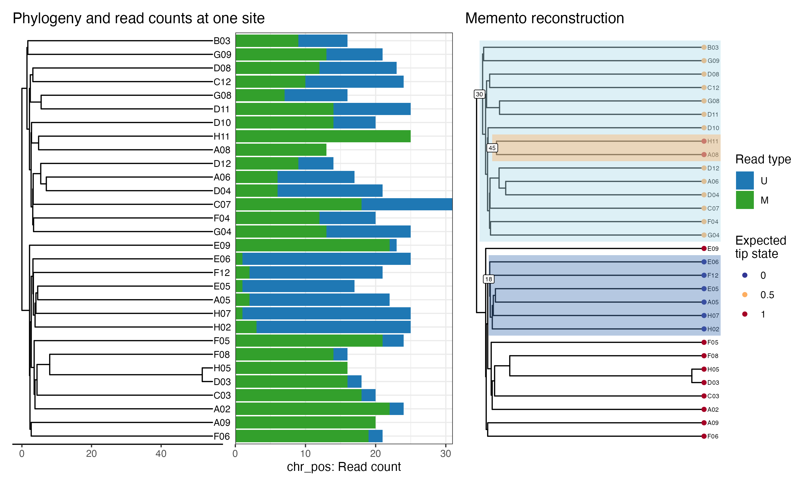

<!-- README.md is generated from README.Rmd. Please edit that file -->

```{r, include = FALSE}
knitr::opts_chunk$set(
  collapse = TRUE,
  comment = "#>",
  fig.path = "man/figures/README-",
  out.width = "100%"
)
```

# Memento

<!-- badges: start -->
<!-- badges: end -->

Memento is a suite of functions to find change points in phenotype states on a phylogeny.



Suppose you know the number of methylated and unmethylated (M and U, respectively, in the figure above) read counts at a CpG site across all tips of a phylogeny. The question Memento addresses is, assuming states are inherited by descendant nodes, what state changes along the branches of the phylogeny would best explain the observed read counts.

Memento will take two vectors of counts as well as the phylogeny of tips and return the most likely root state, which branches changed and what type of change occurred on the branches. The underlying model is a binomial one, where the two vectors of counts are a vector of _successes_ and a vector of _trials_. Memento relies on naive Bayes as it generates all possible tip state vectors for up to $m$ number of independent changes on a phylogeny and then compares the observed data to each possible expected vector of tip states. The expected tip vector with highest similarity to observed is selected and since we know how the expected tip vector was generated, we thus infer the root state and which branches changed to produce the observed data.

Since Memento relies on exhaustive search, generating expected tip states for many independent changes on a phylogeny quickly becomes computationally prohibitive as number of branch permutations grows exponentially. To address this, Memento can split the phylogeny, infer most likely state changes on each sub-phylogeny and then combine the partial solutions to infer the most likely solution for the full phylogeny. For this, it uses an expectation-maximisation approach.

Memento also works on phased data and can infer whether a change happened on maternal and/or paternal chromosome. This is referred to as the 4 state model.

Since Memento computes probabilities for a large set of possible tip states, it can also return second, third etc. best solution for a given CpG site, but only in the non-split setting.

Memento also contains several visualisation functions to plot the found changes.

Priors assume longer branches are more likely to have changed than shorter ones and fewer changes are more likely than several. For example, if one solution proposes two descendant branches from a node both underwent the same transition, and another solution proposes the ancestral branch of the node underwent that transition, the latter will be more likely if all branch lengths are identical.

## Nota Bene

Memento expects phylogeny tip labels to contain characters - ensure this is the case! In addition, when supplying lists of read counts to functions, ensure the matrices are named correctly. See the vignette for examples, this is especially important when dealing with phased data.

This library is under development so some unexpected behaviour may occur. Drop me an email if you require help, I'm at LD18 at sanger dot ac dot uk.

## Installation

Memento depends on a few libraries that are distributed through Bioconductor rather than CRAN. Install them first:

```r
if (!requireNamespace("BiocManager", quietly = TRUE))
    install.packages("BiocManager")
BiocManager::install(c("ggtree", "DelayedArray", "HDF5Array", "S4Arrays"))
```

Then install memento from GitHub:

```r
if (!requireNamespace("remotes", quietly = TRUE))
    install.packages("remotes")
remotes::install_github("ldkregar/memento")
```

```{r eval=FALSE, echo = FALSE}
# You'll still need to render `README.Rmd` regularly, to keep `README.md` up-to-date. `devtools::build_readme()` is handy for this. You could also use GitHub Actions to re-render `README.Rmd` every time you push. An example workflow can be found here: <https://github.com/r-lib/actions/tree/v1/examples>.
# 
# In that case, don't forget to commit and push the resulting figure files, so they display on GitHub and CRAN.
```
