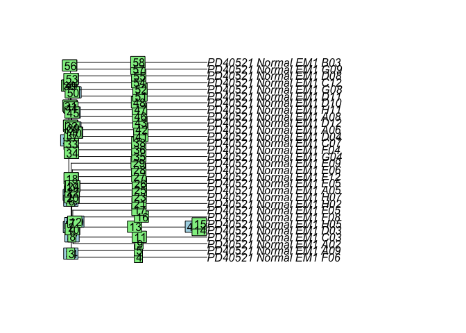
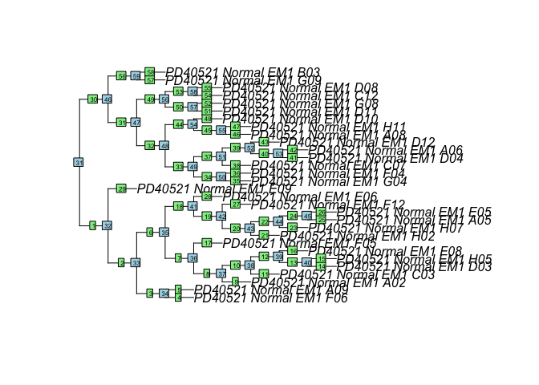
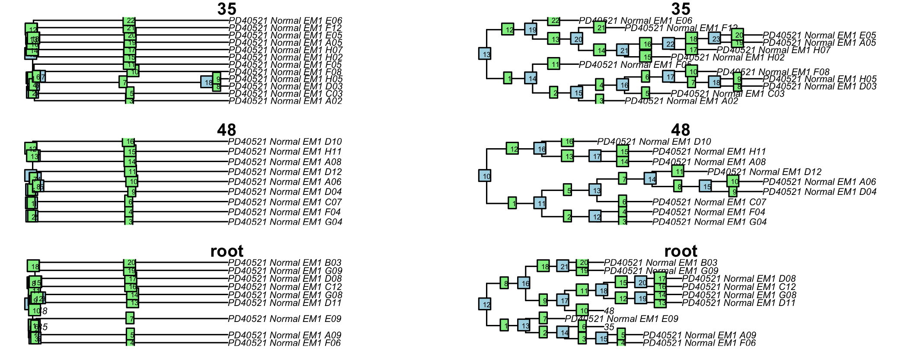

<!-- README.md is generated from README.Rmd. Please edit that file -->

# Memento

<!-- badges: start -->
<!-- badges: end -->

Memento is a suite of functions to find change points in phenotype
states on a phylogeny.

Suppose you know the number of methylated and unmethylated read counts
at a CpG site across all tips of a phylogeny. The question Memento
addresses is whether the tip states are inherited from the root and
whether any of the internal nodes changed its state, which was then
inherited by its descendants.

Memento will take two vectors of counts as well as the phylogeny of tips
and return the most likely root state, which branches changed and what
type of change occurred on the branches. Memento relies on naive Bayes
as it generates all possible tip state vectors for up to m number of
independent changes on a phylogeny and then compares the observed data
to each possible expected vector of tip states. The vector with highest
similarity is selected and since we know how that vector was generated,
we can infer the root state and which branches changed.

Something about number of combinations

If the phylogeny is very big (say, contains more than 20 tips), Memento
allows the user to split the tree, infer most likely state changes on
each subtree and then combine the partial solutions to infer the most
likely solution for the full tree.

Memento also works on phased data and can infer whether a change
happened on maternal and/or paternal chromosome. This is referred to as
the 4 state model.

Since Memento computes probabilities for a large set of possible tip
states, it can also return second, third … best solution.

Memento also contains several visualisation functions.

Priors assume x.

## Installation

You can install the development version of Memento from
[GitHub](https://github.com/) with:

``` r
# install.packages("devtools")
devtools::install_github("ldkregar/memento")
```

## Example for three states

Let’s load an object of simulated data for 100 sites.

``` r
library(ape)
library(data.table)
library(memento)

data("sim_object")
object <- sim_object
str(object)
#> List of 8
#>  $ details:'data.frame': 100 obs. of  9 variables:
#>   ..$ S.root     : num [1:100] 1 2 1 0 2 1 1 2 0 2 ...
#>   ..$ uid        : int [1:100] 1 2 3 4 5 6 7 8 9 10 ...
#>   ..$ d0         : num [1:100] 0 0 0 836 0 ...
#>   ..$ d1         : num [1:100] 842.17 0 842.17 5.88 0 ...
#>   ..$ d2         : num [1:100] 0 842 0 0 842 ...
#>   ..$ Chrom      : num [1:100] 1 1 1 1 1 1 1 1 1 1 ...
#>   ..$ Pos        : int [1:100] 1 2 3 4 5 6 7 8 9 10 ...
#>   ..$ cpg_context: chr [1:100] "NA" "NA" "NA" "NA" ...
#>   ..$ hmm_E035   : chr [1:100] "NA" "NA" "NA" "NA" ...
#>  $ G      : num [1:100, 1:30] 1 2 1 0 2 1 1 2 0 2 ...
#>  $ tree   :List of 6
#>   ..$ edge       : int [1:58, 1:2] 31 32 33 34 34 33 35 36 37 37 ...
#>   ..$ edge.length: num [1:58] 0.5322 0.0295 0.0869 29.1015 29.1015 ...
#>   ..$ Nnode      : int 29
#>   ..$ node.label : chr [1:29] "" "100" "1" "0" ...
#>   ..$ tip.label  : chr [1:30] "PD40521_Normal_EM1_F06" "PD40521_Normal_EM1_A09" "PD40521_Normal_EM1_A02" "PD40521_Normal_EM1_C03" ...
#>   ..$ nstates    : num 3
#>   ..- attr(*, "class")= chr "phylo"
#>   ..- attr(*, "order")= chr "cladewise"
#>  $ meta   :'data.frame': 30 obs. of  3 variables:
#>   ..$ sample: chr [1:30] "PD40521_Normal_EM1_F06" "PD40521_Normal_EM1_A09" "PD40521_Normal_EM1_A02" "PD40521_Normal_EM1_C03" ...
#>   ..$ gamma : num [1:30] 0.05 0.05 0.05 0.05 0.05 0.05 0.05 0.05 0.05 0.05 ...
#>   ..$ delta : num [1:30] 0.05 0.05 0.05 0.05 0.05 0.05 0.05 0.05 0.05 0.05 ...
#>  $ MF     : int [1:100, 1:30] 5 6 5 1 5 3 3 6 0 3 ...
#>  $ MR     : int [1:100, 1:30] 2 5 4 1 5 3 1 1 1 5 ...
#>  $ UR     : int [1:100, 1:30] 4 0 2 5 1 1 3 0 5 1 ...
#>  $ UF     : int [1:100, 1:30] 3 1 1 3 0 3 1 0 6 0 ...
```

Followed by a bit of data cleaning…

``` r
meth_mtx <<- object$MF + object$MR
unmeth_mtx <<- object$UF + object$UR
colnames(meth_mtx) <- colnames(unmeth_mtx) <- object$tree$tip.label
chr_pos_object <- paste0(object$details$Chrom, "_", object$details$Pos)
rownames(meth_mtx) <- rownames(unmeth_mtx) <- chr_pos_object

df_meta <- object$meta
filters <- object$filter.param
dt_annotation <- data.table(object$details)
dt_annotation[, chr_pos := paste0(Chrom, "_", Pos)]
setkey(dt_annotation, chr_pos)

tree <- object$tree
range(tree$edge.length)
#> [1]  0.0291055 29.3378301
```

The tree’s branch lengths are in units of years (the individual’s age).
However, Memento assumes branch lengths represent the number of single
nucleotide variants (SNVs). Assuming each cell acquires 20 SNVs per
year, we rescale the branch lengths to correspond to that. To avoid
zero-length branches, we convert the bifurcating tree to a polytomous
one.

``` r
tree$edge.length <- tree$edge.length*20
tree_di <- tree
tree <- di2multi(tree) # convert to polytomy
tree
#> 
#> Phylogenetic tree with 30 tips and 29 internal nodes.
#> 
#> Tip labels:
#>   PD40521_Normal_EM1_F06, PD40521_Normal_EM1_A09, PD40521_Normal_EM1_A02, PD40521_Normal_EM1_C03, PD40521_Normal_EM1_D03, PD40521_Normal_EM1_H05, ...
#> Node labels:
#>   , 100, 1, 0, 0, 28, ...
#> 
#> Rooted; includes branch lengths.
{plot.phylo(tree)
nodelabels()
edgelabels()}
```



Everything is overlapping. Let’s see what a tree in which each branch
length is 1 unit long looks like.

``` r
unit_tree <- tree
unit_tree$edge.length <- rep(1, length(unit_tree$edge.length))
{plot.phylo(unit_tree)
nodelabels(cex = 0.5)
edgelabels(cex = 0.5)}
```



That’s better.

Here, we’ll be working with the three state model. The three states are
demethylated, half-methylated and methylated, which corresponds to 0,
0.5 and 1 methlyated read fraction, respectively. The fraction is
computed by dividing the number of methlyated reads by the total number
of reads at that site. As there are 3 states, there are 9 possible
transitions. To change the settings to a four state model, run
set_memento_settings(new_number_of_states = 4).

``` r
memento_settings()
#> $number_of_states
#> [1] 3
#> 
#> $all_possible_states
#> [1] 1 2 3
#> 
#> $state_transition_mtx
#>   1 2 3
#> 1 1 2 3
#> 2 4 5 6
#> 3 7 8 9
#> 
#> $state_transition_vec_out
#> [1] 1 2 3 1 2 3 1 2 3
#> 
#> $human.snv.rate.per.base
#> [1] 6.666667e-09
#> 
#> $length_change_comb_list
#> [1] 11
```

The table below shows which state each transition starts from (row) and
ends at (column).

<table>
<caption>
State transition matrix
</caption>
<thead>
<tr>
<th style="text-align:left;">
</th>
<th style="text-align:right;">
1 (0)
</th>
<th style="text-align:right;">
2 (0.5)
</th>
<th style="text-align:right;">
3 (1)
</th>
</tr>
</thead>
<tbody>
<tr>
<td style="text-align:left;">
1 (0)
</td>
<td style="text-align:right;">
1
</td>
<td style="text-align:right;">
2
</td>
<td style="text-align:right;">
3
</td>
</tr>
<tr>
<td style="text-align:left;">
2 (0.5)
</td>
<td style="text-align:right;">
4
</td>
<td style="text-align:right;">
5
</td>
<td style="text-align:right;">
6
</td>
</tr>
<tr>
<td style="text-align:left;">
3 (1)
</td>
<td style="text-align:right;">
7
</td>
<td style="text-align:right;">
8
</td>
<td style="text-align:right;">
9
</td>
</tr>
</tbody>
</table>

Let’s find changes. First we compute the priors, which are the
probabilities of each expected tip state vector. We set m to 2, meaning
we will find up to 2 independent changes on the phylogeny. We set
n_top_br to 2, meaning we ask for best two assignments to be returned.

``` r
priors <- generate_priors(full_tree = tree, m = 2)
#> Computing priors for tree root (1 of 1)
# find changes on each subtree
assignments_full <- compute_probabilities(priors_per_tree = priors,
                                     m_reads_matrix = meth_mtx,
                                     u_reads_matrix = unmeth_mtx, 
                                     n_top_br = 2,
                                     ro = 0.95, 
                                     verbose = TRUE)
#> Now working on tree with 30 tips: PD40521_Normal_EM1_F06, PD40521_Normal_EM1_A09, PD40521_Normal_EM1_A02, PD40521_Normal_EM1_C03, PD40521_Normal_EM1_D03, PD40521_Normal_EM1_H05, PD40521_Normal_EM1_F08, PD40521_Normal_EM1_F05, PD40521_Normal_EM1_H02, PD40521_Normal_EM1_H07, PD40521_Normal_EM1_A05, PD40521_Normal_EM1_E05, PD40521_Normal_EM1_F12, PD40521_Normal_EM1_E06, PD40521_Normal_EM1_E09, PD40521_Normal_EM1_G04, PD40521_Normal_EM1_F04, PD40521_Normal_EM1_C07, PD40521_Normal_EM1_D04, PD40521_Normal_EM1_A06, PD40521_Normal_EM1_D12, PD40521_Normal_EM1_A08, PD40521_Normal_EM1_H11, PD40521_Normal_EM1_D10, PD40521_Normal_EM1_D11, PD40521_Normal_EM1_G08, PD40521_Normal_EM1_C12, PD40521_Normal_EM1_D08, PD40521_Normal_EM1_G09, PD40521_Normal_EM1_B03
#> Dim meth: 100, 30
#> Dim unmeth: 100, 30
#> Dim genotype: 30, 20187
head(assignments_full, 10)
#>     chr_pos rank probability      branch only_branch starting_state
#>  1:     1_1    1 0.556247482       n.2:5           n              2
#>  2:     1_1    2 0.264672962       9.2:4           9              2
#>  3:    1_10    1 0.968121588       n.3:9           n              3
#>  4:    1_10    2 0.006102008      55.3:8          55              3
#>  5:   1_100    1 0.893292825       n.3:9           n              3
#>  6:   1_100    2 0.050730020      29.3:8          29              3
#>  7:    1_11    1 0.858374064      46.3:7          46              3
#>  8:    1_11    2 0.070507264 46_55.3:7_8       46_55              3
#>  9:    1_12    1 0.567715544      58.3:8          58              3
#> 10:    1_12    2 0.359407749       n.3:9           n              3
#>     branch_state ss_1     ss_2     ss_3 nt_1 nt_2 nt_3 nt_4 nt_5 nt_6 nt_7 nt_8
#>  1:            5    0 16843.31     0.00    0    0    0    0   58    0    0    0
#>  2:            4    0 16843.31     0.00    0    0    0    1   57    0    0    0
#>  3:            9    0     0.00 16843.31    0    0    0    0    0    0    0    0
#>  4:            8    0     0.00 16843.31    0    0    0    0    0    0    0    1
#>  5:            9    0     0.00 16843.31    0    0    0    0    0    0    0    0
#>  6:            8    0     0.00 16843.31    0    0    0    0    0    0    0    1
#>  7:            7    0     0.00 16843.31    0    0    0    0    0    0    1    0
#>  8:          7_8    0     0.00 16843.31    0    0    0    0    0    0    1    1
#>  9:            8    0     0.00 16843.31    0    0    0    0    0    0    0    1
#> 10:            9    0     0.00 16843.31    0    0    0    0    0    0    0    0
#>     nt_9
#>  1:    0
#>  2:    0
#>  3:   58
#>  4:   57
#>  5:   58
#>  6:   57
#>  7:   57
#>  8:   56
#>  9:   57
#> 10:   58
```

Great, we have assignments for each site. The columns only_branch,
starting_state and branch_state show which branches changed, the
starting state at the root node and which transitions the branches
underwent. The column probability contains the probability of the
assignment. Columns that start with ss contain the sum of branch
lengths, which start in each possible state (here 1, 2 or 3, which
correspond to demethylated, half-methylated and methylated,
respectively). Columns that start with nt show the number of transitions
of each type that occurred in that assignment.

In the first row, the most likely assignment for this position is “n”,
which means “no branch” and the root and tip states are the same. The
starting state is inferred to be in state 2 (half-methylated) and branch
changes are of type 5 (the transition is from state 0.5 to 0.5). This
assignment has a probability of 55%. The second row reports the second
most likely assignment for this position and it has a probability of
26%.

Position 1_11 (row 7) is most likely to have changed on branch 46. The
root starting state is 3 (i.e. 1 or methylated) and branch 46 underwent
transition 7, which is a change from 1 to 0.5.

Let’s see what these assignments actually look like.

This tree is kind of big though. If we allow more than 3 independent
changes, computing the priors will be time consuming. To avoid this, we
can split the tree into smaller subtrees, and assign changes to each
subtree. Allowing 3 changes per subtree across 2 subtrees, we can find
up to 6 changes on the full tree (2 subtrees \* 3 changes per subtree).

``` r
subtrees <- divide_tree_into_subtrees(full_tree = tree, max_subtree_size = 15)
#> Error in generate_tree_partition(tree = problematic_tree, cutoff_upper = max_subtree_size, : Cannot create tree - modify cutoffs (upper: 15, lower: 5) or input custom node list.
```

Sometimes, the tree doesn’t fall apart into subtrees *nicely*. Try to
play around with various cutoffs (aim for between 5 and 20 tips per
subtree), or you can provide a list of custom nodes to use as subtree
roots. This requires manual inspection of the tree and hand picking the
nodes.

``` r
subtrees <- divide_tree_into_subtrees(full_tree = tree, max_subtree_size = 12)
```

Yay, this worked. Let’s see what these look like.

``` r
j <- rep(c(1:3), each = 2)
par(mfrow = c(3, 2),
    mar = c(1, 1, 1, 1))
for(i in 1:6){
  my_tree <- subtrees[[j[i]]]
  if(i %% 2 == 0){
    my_tree_unit <- my_tree
    my_tree_unit$edge.length <- rep(1, length(my_tree_unit$edge.length))
    {plot.phylo(my_tree_unit, main = names(subtrees)[j[i]])
      nodelabels(cex = 0.5)
      edgelabels(cex = 0.5)}
  }else{
    {plot.phylo(my_tree, main = names(subtrees)[j[i]])
      nodelabels(cex = 0.5)
      edgelabels(cex = 0.5)}
  }

}
```


Nice. Let’s compute the priors and find changes on each subtree.

``` r
# compute priors
priors_p_subtree <- generate_priors(all_trees = subtrees, full_tree = tree)
#> Computing priors for tree 35 (1 of 3)
#> Computing priors for tree 48 (2 of 3)
#> Computing priors for tree root (3 of 3)

# find changes on each subtree
assignments <- lapply(priors_p_subtree,
                      compute_probabilities, 
                      m_reads_matrix = meth_mtx,
                      u_reads_matrix = unmeth_mtx, 
                      ro = 0.95, 
                      verbose = TRUE)
#> Now working on tree with 12 tips: PD40521_Normal_EM1_A02, PD40521_Normal_EM1_C03, PD40521_Normal_EM1_D03, PD40521_Normal_EM1_H05, PD40521_Normal_EM1_F08, PD40521_Normal_EM1_F05, PD40521_Normal_EM1_H02, PD40521_Normal_EM1_H07, PD40521_Normal_EM1_A05, PD40521_Normal_EM1_E05, PD40521_Normal_EM1_F12, PD40521_Normal_EM1_E06
#> Dim meth: 100, 30
#> Dim unmeth: 100, 30
#> Dim genotype: 30, 2907
#> Now working on tree with 9 tips: PD40521_Normal_EM1_G04, PD40521_Normal_EM1_F04, PD40521_Normal_EM1_C07, PD40521_Normal_EM1_D04, PD40521_Normal_EM1_A06, PD40521_Normal_EM1_D12, PD40521_Normal_EM1_A08, PD40521_Normal_EM1_H11, PD40521_Normal_EM1_D10
#> Dim meth: 100, 30
#> Dim unmeth: 100, 30
#> Dim genotype: 30, 1539
#> Now working on tree with 11 tips: PD40521_Normal_EM1_F06, PD40521_Normal_EM1_A09, 35, PD40521_Normal_EM1_E09, 48, PD40521_Normal_EM1_D11, PD40521_Normal_EM1_G08, PD40521_Normal_EM1_C12, PD40521_Normal_EM1_D08, PD40521_Normal_EM1_G09, PD40521_Normal_EM1_B03
#> Dim meth: 100, 30
#> Dim unmeth: 100, 30
#> Dim genotype: 30, 2403
head(assignments[[1]])
#>    chr_pos rank probability branch only_branch starting_state branch_state
#> 1:     1_1    1 0.672594971  n.2:5           n              2            5
#> 2:     1_1    2 0.320033275  3.2:4           3              2            4
#> 3:    1_10    1 0.990097864  n.3:9           n              3            9
#> 4:    1_10    2 0.004279573 22.3:8          22              3            8
#> 5:   1_100    1 0.987453959  n.3:9           n              3            9
#> 6:   1_100    2 0.008051555 17.3:8          17              3            8
```

This is a table of changes on each subtree. But branches are numbered
relative to the subtree root, so we have to find which branch on the
full tree they would correspond to.

``` r
# find candidate changes on the full tree
converted_dt <- convert_sub_to_full_tree_branches(assignments = assignments,
                                                  subtrees = subtrees,
                                                  full_tree = tree)
#> Converting branches for tree 35: 1 of 3
#> Converting branches for tree 48: 2 of 3
#> Converting branches for tree root: 3 of 3
#> Rank column suggests there are several top solutions, filtering to rank = 1 only
head(converted_dt)
#>    chr_pos rank combined_branch ss_root_tree probability_root n_assignments
#> 1:     1_1    1               n            2        0.9146118             0
#> 2:    1_10    1               n            3        0.9808322             0
#> 3:   1_100    1               n            3        0.9366650             0
#> 4:    1_11    1              46            3        0.9122586             1
#> 5:    1_12    1              58            3        0.6050139             1
#> 6:    1_13    1               n            3        0.9915421             0
```

Sweet, the combined branch column shows which branches might have
changed on the full tree. These were obtained per subtree and since each
subtree can have a different starting state, we do not know which state
transitions happened on each branch. We also do not know the probability
of branch changes on the full tree.

We would like to get a parsimonious solution for the full tree, where we
will know the most likely starting state at root, which branches changed
and which states they transitioned from and to along with the solution’s
probability. To obtain this, we permute the candidate branches on the
full tree and estimate their probability. We start with the full set
(including all candidate changes) and a leave-one-out set. If the
smaller set contains the most probable solution, we estimate the
probability for a set that drops another branch, repeating the process
until the not-smallest set contains the solution.

``` r
mle_branch_dt <- find_most_likely_set(dt_pre =  converted_dt,
                                      full_tree = tree,
                                      ro = 0.95,
                                      n_top_br = 2,
                                      m_mtx = meth_mtx,
                                      u_mtx = unmeth_mtx,
                                      fraction_estimate = 1,
                                      verbose = FALSE,
                                      dt_anno = dt_annotation)
head(mle_branch_dt)
#>    chr_pos combined_branch ss_root_tree probability_root n_assignments rank
#> 1:     1_1               n            2        0.9146118             0    1
#> 2:     1_1               n            2        0.9146118             0    2
#> 3:    1_10               n            3        0.9808322             0    1
#> 4:    1_10               n            3        0.9808322             0    2
#> 5:   1_100               n            3        0.9366650             0    1
#> 6:   1_100               n            3        0.9366650             0    2
#>      probability branch only_branch starting_state branch_state
#> 1:  1.000000e+00  n.2:5           n              2            5
#> 2: 2.075996e-102  n.3:9           n              3            9
#> 3:  1.000000e+00  n.3:9           n              3            9
#> 4:  1.910144e-65  n.2:5           n              2            5
#> 5:  1.000000e+00  n.3:9           n              3            9
#> 6:  1.526218e-62  n.2:5           n              2            5
#>    n_assignments_mle ss_1     ss_2     ss_3 nt_1 nt_2 nt_3 nt_4 nt_5 nt_6 nt_7
#> 1:                 0    0 16843.31     0.00    0    0    0    0   58    0    0
#> 2:                 0    0 16843.31     0.00    0    0    0    0   58    0    0
#> 3:                 0    0     0.00 16843.31    0    0    0    0    0    0    0
#> 4:                 0    0     0.00 16843.31    0    0    0    0    0    0    0
#> 5:                 0    0     0.00 16843.31    0    0    0    0    0    0    0
#> 6:                 0    0     0.00 16843.31    0    0    0    0    0    0    0
#>    nt_8 nt_9 S.root uid d0       d1       d2 Chrom Pos cpg_context hmm_E035
#> 1:    0    0      1   1  0 842.1654   0.0000     1   1          NA       NA
#> 2:    0    0      1   1  0 842.1654   0.0000     1   1          NA       NA
#> 3:    0   58      2  10  0   0.0000 842.1654     1  10          NA       NA
#> 4:    0   58      2  10  0   0.0000 842.1654     1  10          NA       NA
#> 5:    0   58      2 100  0   0.0000 842.1654     1 100          NA       NA
#> 6:    0   58      2 100  0   0.0000 842.1654     1 100          NA       NA
```

Nice, we obtained the best two solutions for each site.

Let’s see what these changes look like.

You’ll still need to render `README.Rmd` regularly, to keep `README.md`
up-to-date. `devtools::build_readme()` is handy for this. You could also
use GitHub Actions to re-render `README.Rmd` every time you push. An
example workflow can be found here:
<https://github.com/r-lib/actions/tree/v1/examples>.

In that case, don’t forget to commit and push the resulting figure
files, so they display on GitHub and CRAN.
